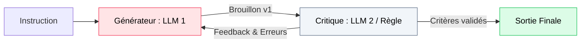
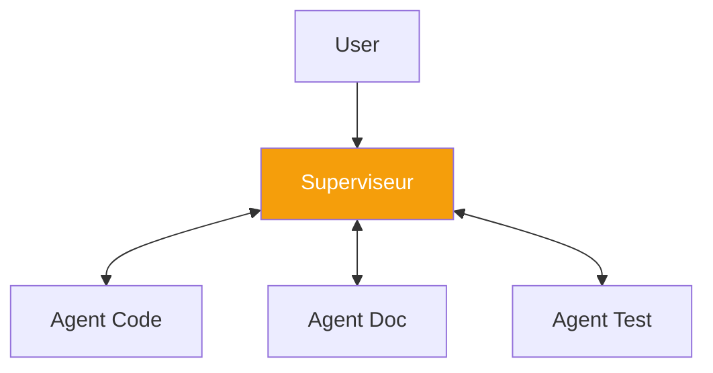
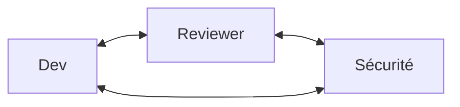
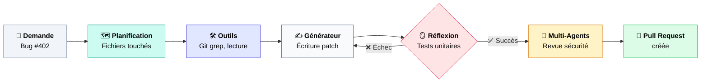

---
# try also 'default' to start simple
theme: seriph
# random image from a curated Unsplash collection by Anthony
# like them? see https://unsplash.com/collections/94734566/slidev
background: https://cover.sli.dev
# some information about your slides (markdown enabled)
title: MODULE 4 — Les 4 patrons de conception agentiques
info: |
  ## Cours Agentic AI 
# apply UnoCSS classes to the current slide
class: text-center
# https://sli.dev/features/drawing
pdf: true
export: true
drawings:
  persist: false
# slide transition: https://sli.dev/guide/animations.html#slide-transitions
transition: slide-left
# enable Comark Syntax: https://comark.dev/syntax/markdown
comark: true
download: true
# duration of the presentation
duration: 10min
---

# Module 4 : Les 4 Patrons de Conception Agentiques
## Les architectures fondamentales de l'IA agentique

<div class="pt-12">
  <span class="px-3 py-1 rounded bg-rose-600/60 text-sm font-mono">Design Patterns & Ingénierie des flux</span>
  <p class="mt-4 text-gray-300 text-sm">Inspiré des travaux et analyses d'Andrew Ng sur les flux de travail agentiques</p>
</div>

---
layout: default
---

# L'intuition d'Andrew Ng : Le flux est un levier aussi important que la taille du modèle

<div class="text-xl text-rose-500 font-semibold mb-4">
  « Sur des benchmarks ciblés (QA médical, HumanEval), un modèle plus petit orchestré par un bon patron agentique peut surpasser un modèle géant interrogé en Zero-Shot. »
</div>

<div class="p-2 mb-4 bg-amber-50 dark:bg-amber-950 border border-amber-500/30 rounded text-[11px] text-gray-600 dark:text-gray-300">
  ⚠️ Observation empirique d'Andrew Ng (2024), pas une loi universelle : la supériorité dépend de la tâche, du patron et du modèle. Le workflow est un levier au moins aussi important que la taille — mais il peut aussi s'inverser sur certaines tâches.
</div>

<div class="grid grid-cols-4 gap-4 mt-4 text-center text-xs">

  <div class="p-4 border-2 border-rose-500 rounded-xl bg-rose-50 dark:bg-rose-950 flex flex-col justify-between">
    <div>
      <div class="text-2xl mb-1">🪞</div>
      <div class="font-bold text-sm text-rose-600">1. Réflexion</div>
      <p class="text-gray-500 mt-2">Critiquer et raffiner itérativement son propre résultat.</p>
    </div>
    <div class="font-mono text-[10px] text-gray-400 mt-3">Generator / Critic</div>
  </div>

  <div class="p-4 border border-gray-200 dark:border-gray-800 rounded-xl bg-gray-50 dark:bg-gray-800 flex flex-col justify-between">
    <div>
      <div class="text-2xl mb-1">🛠️</div>
      <div class="font-bold text-sm text-indigo-500">2. Usage d'outils</div>
      <p class="text-gray-500 mt-2">Déléguer calculs, recherches et actions au monde extérieur.</p>
    </div>
    <div class="font-mono text-[10px] text-gray-400 mt-3">Tool Use / Calling</div>
  </div>

  <div class="p-4 border border-gray-200 dark:border-gray-800 rounded-xl bg-gray-50 dark:bg-gray-800 flex flex-col justify-between">
    <div>
      <div class="text-2xl mb-1">🗺️</div>
      <div class="font-bold text-sm text-teal-500">3. Planification</div>
      <p class="text-gray-500 mt-2">Décomposer un objectif vaste en une suite d'étapes ciblées.</p>
    </div>
    <div class="font-mono text-[10px] text-gray-400 mt-3">Task Decomposition</div>
  </div>

  <div class="p-4 border border-gray-200 dark:border-gray-800 rounded-xl bg-gray-50 dark:bg-gray-800 flex flex-col justify-between">
    <div>
      <div class="text-2xl mb-1">👥</div>
      <div class="font-bold text-sm text-amber-500">4. Multi-Agents</div>
      <p class="text-gray-500 mt-2">Faire collaborer des personas spécialisés avec rôles stricts.</p>
    </div>
    <div class="font-mono text-[10px] text-gray-400 mt-3">Orchestration</div>
  </div>

</div>

---
layout: default
---

# 1. Patron Réflexion (Reflection)

Ne jamais se contenter du premier jet : instaurer une boucle d'auto-évaluation.

<div class="mt-4 flex justify-center">



</div>

<div class="grid grid-cols-2 gap-6 mt-6 text-xs">
<div>

### Deux types d'agents dans la boucle :
- **L'Acteur / Générateur :** Produit le code, le texte ou la réponse en suivant la consigne.
- **Le Critique :** Reçoit le brouillon avec une consigne d'exigence :  
  *« Analyse le code ci-dessus, cherche les failles de sécurité et les cas limites non gérés. Rédige un retour constructif. »*

</div>
<div>

### Pourquoi ça marche ?
En mode direct (Zero-shot), le modèle n'effectue qu'**une seule passe de génération** : pas d'itération, pas de vérification. La réflexion lui accorde du **temps de calcul au moment de l'inférence** (*test-time compute*) et un **contexte enrichi de ses propres erreurs**.

</div>
</div>

---
layout: two-cols-header
---

# Réflexion : Feedback interne vs externe

Le piège de la réflexion purement textuelle : le modèle peut s'auto-persuader de ses erreurs.

::left::
### Auto-évaluation interne (LLM seul)
- Le modèle critique son propre texte.
- **Risque fort :** Hallucination en boucle (*« Ce code est parfait »* alors qu'il ne compile pas).
- Efficace surtout pour le style, la grammaire et la clarté pédagogique.

::right::

<div class="ml-4">

### Feedback externe (Ancré au réel)
- La critique s'appuie sur une **vérité système déterministe** :
  - Un compilateur ou linter (`flake8`, `tsc`)
  - Une suite de tests unitaires (`pytest`)
  - Un interpréteur de code ou un humain

<div class="p-2 mt-3 bg-rose-50 dark:bg-rose-950 border border-rose-500/30 rounded text-[11px]">
  💡 <b>Règle d'or :</b> Pour la <b>correction objective</b> (code, faits), la réflexion doit s'ancrer sur un feedback déterministe — compilateur, tests, exécution. L'avis d'un LLM est utile pour la <b>qualité subjective</b> (style, lisibilité), mais ne doit jamais être l'unique source de vérité.
</div>

<div class="p-2 mt-2 bg-gray-100 dark:bg-gray-800 rounded text-[11px] text-gray-600 dark:text-gray-300">
  🔁 <b>En production :</b> bornez la boucle (<code>max_iterations</code> ≈ 3 à 5) — une critique qui diverge peut faire exploser le budget tokens.
</div>

</div>

---
layout: default
---

# 2. Patron Usage d'Outils (Tool Use)

Le modèle s'affranchit de sa coquille textuelle en pilotant du code externe.

<div class="grid grid-cols-2 gap-6 mt-4">
<div>

### Le LLM comme routeur d'API :
1. L'agent reçoit une palette d'outils documentés avec leur schéma d'entrée (JSON Schema).
2. Il décide en toute autonomie :
   - Quel outil appeler
   - Avec quels paramètres extraits du contexte
3. Le runtime exécute la fonction et lui réinjecte le résultat.

```json
// Exemple d'appel émis par l'agent :
{
  "name": "search_calendar",
  "arguments": {
    "date": "2026-10-20",
    "attendee": "marie@univ.fr"
  }
}
```

<div class="p-2 mt-3 bg-rose-50 dark:bg-rose-950 border border-rose-500/30 rounded text-[11px]">
  ⚠️ <b>Piège classique :</b> le modèle peut choisir le bon outil mais inventer un argument ou un type invalide. Validez systématiquement les arguments côté runtime (JSON Schema strict / <code>pydantic</code>) et cloisonnez les outils sensibles (emails, écritures) par des permissions.
</div>

</div>

<div class="space-y-3 text-xs">

<div class="p-3 border rounded bg-gray-50 dark:bg-gray-800">
  <div class="font-bold text-indigo-500">🔍 Recherche & Connaissance</div>
  Interrogation du Web (Tavily), de bases vectorielles d'entreprise ou de logs Elastic.
</div>

<div class="p-3 border rounded bg-gray-50 dark:bg-gray-800">
  <div class="font-bold text-indigo-500">📅 Actions Métier</div>
  Création d'événements, envoi d'emails transactionnels, mise à jour de tickets Jira.
</div>

<div class="p-3 border rounded bg-gray-50 dark:bg-gray-800">
  <div class="font-bold text-indigo-500">💻 Calcul Exact & Sandbox</div>
  Génération et exécution de scripts Python pour manipuler des données (pandas, numpy).
</div>

</div>
</div>

---
layout: default
---

# 3. Patron Planification (Planning)

Pour les problèmes vastes, l'agent doit structurer sa démarche avant de foncer tête baissée.

<div class="grid grid-cols-2 gap-6 mt-4">
<div>

### 1. Planification Statique (Plan-and-Solve)
- L'agent produit la liste exhaustive des étapes, puis les exécute séquentiellement sans dévier.
- **Faiblesse :** Si l'étape 2 échoue, tout le reste du plan s'effondre.

### 2. Planification Adaptative (Re-planning)
- À chaque fin d'étape, l'agent observe le résultat et réajuste dynamiquement les étapes restantes.
- Capable de contourner un blocage technique imprévu.

</div>

<div class="p-3 bg-gray-900 text-gray-100 rounded-lg font-mono text-[11px] leading-relaxed">
  <div class="text-teal-400 font-bold">// Plan déclaratif (JSON) généré par l'agent :</div>
  {<br/>
  &nbsp;&nbsp;"goal": "Migrer la table users vers PostgreSQL",<br/>
  &nbsp;&nbsp;"steps": [<br/>
  &nbsp;&nbsp;&nbsp;&nbsp;{"id": 1, "task": "Dump schéma SQLite", "status": "DONE"},<br/>
  &nbsp;&nbsp;&nbsp;&nbsp;{"id": 2, "task": "Convertir types SQL", "status": "IN_PROGRESS"},<br/>
  &nbsp;&nbsp;&nbsp;&nbsp;{"id": 3, "task": "Injecter données", "status": "PENDING"},<br/>
  &nbsp;&nbsp;&nbsp;&nbsp;{"id": 4, "task": "Vérifier intégrité", "status": "PENDING"}<br/>
  &nbsp;&nbsp;]<br/>
  }
</div>
</div>

<div class="mt-4 text-xs text-gray-500">
  🧠 <b>Deux représentations du plan, deux trade-offs :</b><br/>
  &nbsp;&nbsp;• <b>Déclaratif (JSON)</b> — inspectable, modifiable, auditable → idéal pour le re-planning et la supervision externe.<br/>
  &nbsp;&nbsp;• <b>Impératif (Code-as-Plan)</b> — l'agent écrit un script Python orchestrant les étapes avec des blocs <code>try/except</code> → plus expressif, mais opaque et moins réversible.<br/>
  <span class="text-gray-400">Le choix dépend du besoin d'auditabilité et de contrôle du plan.</span>
</div>

<style>
h3 {
  font-size:1.2em;
}
li {
  font-size:0.9em;
}

</style>

---
layout: two-cols-header
---

# 4. Patron Multi-Agents : Collaboration spécialisée

Diviser pour régner : attribuer des rôles stricts et étanches à plusieurs sous-agents.

::left::
### Pourquoi plusieurs agents ?
- **Hyperspécialisation :** Chaque agent a un System Prompt dédié, un vocabulaire métier et des outils ciblés.
- **Clarté du contexte :** Évite de surcharger la fenêtre d'un seul agent avec des rôles contradictoires.
- **Séparation des pouvoirs :** L'agent qui développe n'est pas celui qui valide la recette.

::right::
<div class="ml-4">

### Exemple d'équipe logicielle :
1. **L'Architecte :** Rédige les spécifications et le découpage des composants.
2. **Le Développeur :** Écrit le code source unitaire selon la spécification.
3. **Le QA / Testeur :** Écrit les tests unitaires et cherche à casser l'implémentation.
4. **Le Reviewer :** Valide la fusion sur la branche principale.

</div>

<div class="mt-6 p-2 bg-amber-50 dark:bg-amber-950 border border-amber-500/30 rounded text-[11px] text-gray-600 dark:text-gray-300">
  ⚠️ <b>Résultat empirique :</b> pour beaucoup de tâches, un <b>seul agent bien prompté + outils</b> bat un multi-agents (moins de coûts, moins de dérives). Le multi-agents ne paie qu'en cas d'<b>isolation de contexte</b>, de <b>vérification croisée</b> (le développeur ≠ le QA) ou d'<b>expertises divergentes</b>.
</div>

---
layout: default
---

# Multi-Agents : Orchestration vs Chorégraphie

Comment faire interagir les agents entre eux sans sombrer dans le chaos ?

<div class="grid grid-cols-2 gap-6 mt-4">

<div class="p-4 border-2 border-amber-500 rounded-xl bg-amber-50 dark:bg-amber-950">
  <div class="font-bold text-amber-600 mb-2">A. Orchestration (Superviseur central)</div>
  <div class="text-xs text-gray-600 dark:text-gray-300">
    Un agent chef d'orchestre reçoit la demande utilisateur, répartit le travail et collecte les résultats.
  </div>


  <div class="mt-2 text-[11px] text-emerald-600 font-semibold">✓ Prévisible, évite le bavardage infini.</div>
</div>

<div class="p-4 border rounded-xl bg-gray-50 dark:bg-gray-800">
  <div class="font-bold text-gray-400 mb-2">B. Chorégraphie (Peer-to-Peer / Consensus)</div>
  <div class="text-xs text-gray-600 dark:text-gray-300">
    Les agents conversent librement sur un bus commun (style salon de discussion).
  </div>


  <div class="mt-2 text-[11px] text-rose-500 font-semibold">⚠️ Coûts en tokens explosifs, risque de blocage.</div>
</div>

</div>

---
layout: default
---

# Quand utiliser quel patron ? Matrice comparative

Chaque patron apporte un gain en performance, mais impose un coût en latence et en tokens :

<div class="mt-4 overflow-x-auto text-xs">
<table class="w-full text-left border-collapse">
  <thead>
    <tr class="border-b border-gray-300 dark:border-gray-700 bg-gray-100 dark:bg-gray-800">
      <th class="p-2 font-bold">Patron</th>
      <th class="p-2 font-bold">Complexité logicielle</th>
      <th class="p-2 font-bold">Surcoût Tokens / Latence</th>
      <th class="p-2 font-bold">Cas d'usage prioritaire</th>
    </tr>
  </thead>
  <tbody>
    <tr class="border-b border-gray-200 dark:border-gray-800">
      <td class="p-2 font-semibold text-rose-500">1. Réflexion</td>
      <td class="p-2">Faible (boucle `while` bornée)</td>
      <td class="p-2">Moyen ($\times 2$ à $\times 4$ selon itérations)</td>
      <td class="p-2">Génération de code sans bugs, rédaction juridique rigoureuse.</td>
    </tr>
    <tr class="border-b border-gray-200 dark:border-gray-800">
      <td class="p-2 font-semibold text-indigo-500">2. Usage d'outils</td>
      <td class="p-2">Moyenne (gestion des schémas d'API + validation)</td>
      <td class="p-2">Faible à modéré</td>
      <td class="p-2">Accès aux données fraîches, calculs mathématiques, actions SI.</td>
    </tr>
    <tr class="border-b border-gray-200 dark:border-gray-800">
      <td class="p-2 font-semibold text-teal-500">3. Planification</td>
      <td class="p-2">Moyenne (machine à états)</td>
      <td class="p-2">Modéré</td>
      <td class="p-2">Tâches multi-étapes longues (audits complets, migrations).</td>
    </tr>
    <tr>
      <td class="p-2 font-semibold text-amber-500">4. Multi-Agents</td>
      <td class="p-2">Élevée (framework type LangGraph / CrewAI)</td>
      <td class="p-2">Très élevé ($\times 5$ à $\times 20$ — ordres de grandeur)</td>
      <td class="p-2">Problèmes complexes nécessitant des expertises divergentes.</td>
    </tr>
  </tbody>
</table>
</div>

<div class="mt-2 p-2 bg-gray-100 dark:bg-gray-800 rounded text-center text-[11px] text-gray-500">
  📐 Les facteurs ×n sont des ordres de grandeur : ils dépendent du nombre de tours de boucle et de la longueur des échanges.
</div>

<div class="mt-2 p-2 bg-emerald-50 dark:bg-emerald-950 border border-emerald-500/30 rounded text-center text-xs">
  💡 <b>Conseil pratique :</b> Commencez toujours par <i>Outils + Réflexion</i> — un seul agent bien configuré + outils suffit souvent — avant d'envisager une architecture <i>Multi-Agents</i>.
</div>

---
layout: default
---

# Combiner les patrons : L'Agent de Développement Moderne

En production, ces patrons ne s'excluent pas : ils s'assemblent en une chaîne cohérente.


<div class="w-full flex justify-center my-4 scale-95 origin-top">



</div>

<div class="mt-5 text-center text-xs text-gray-500">
  Cet assemblage méthodique est exactement ce qui alimente les outils d'ingénierie logicielle modernes (Devin, Cursor Agent, Claude Code).
</div>


---
layout: default
---

# Synthèse du Module 4

<div class="p-5 bg-rose-50 dark:bg-rose-950 border border-rose-500 rounded-xl space-y-3">
  <div class="font-bold text-rose-600 text-lg">À retenir sur les 4 patrons agentiques :</div>
  <ul class="text-sm space-y-2">
    <li><b>Réflexion :</b> Indispensable pour la qualité, mais à ancrer sur des feedbacks déterministes (tests, linters) pour la correction objective — l'avis LLM se limite à la qualité subjective — et à borner en nombre d'itérations.</li>
    <li><b>Usage d'outils :</b> Le socle d'ancrage dans le monde réel ; transforme le LLM en aiguilleur d'APIs — validez les arguments et cloisonnez les outils sensibles.</li>
    <li><b>Planification :</b> Prévient la dérive de contexte sur les tâches complexes par découpage en sous-étapes gérées dynamiquement — le plan déclaratif (JSON) facilite le re-planning et l'audit.</li>
    <li><b>Multi-Agents :</b> Puissant pour l'isolation des contextes et la vérification croisée, mais coûteux : réservez-le aux cas où un superviseur central contrôle strictement les échanges et où un agent unique ne suffit plus.</li>
  </ul>
</div>

<div class="mt-6 text-center text-sm text-gray-500">
  👉 <i>Module 5 à suivre : Technologie, infrastructure & outils.</i>
</div>

---
layout: end
class: text-center
---

# Fin du Module 4
### Questions & retours d'expérience sur les patrons !

En route vers [Technologie, Infrastructure & Outils 🚀](https://olivier.barais.fr/agentic.module5/)

